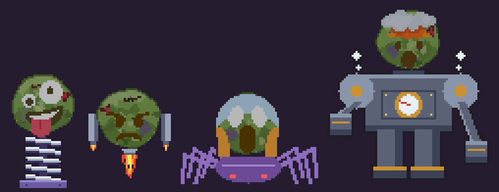

# SlimeJumpFaces



[SlimeJumpHeads](../SlimeJumpHeads) with **emoji faces** for enemies. The game is the same (its numbers are SlimeJumpHeads', unchanged); what is new is where the faces come from:

- the faces are **placed in a level written in emoji** (`level.txt`: the whole shaft, one cell to a world unit),
- each head is **Grease Pencil**: Twemoji's SVG made into a rig by `blender.py` of [3d-emoji-assets-generator](https://github.com/crustos/3d-emoji-assets-generator) (zombie skin, eyes that move, a mouth), rendered by Blender (Cycles, no anti-aliasing) as a 32x32 pixel sprite of 8 frames,
- on a **body drawn as ASCII art** (`tools/slime_faces/bodies.txt`), four frames each, which has a square of magenta `@` where the head goes.

| kind | face | body | animation | where | hp | speed |
|---|---|---|---|---|---|---|
| 2 | 🤪 zany | `body_spring`: a coil spring that squashes and stretches | `crazy_eyes` | room 1 | 2 | 2.2 |
| 3 | 😠 grump | `body_jet`: a jetpack with a flickering flame | `talk` | room 2 | 3 | 1.8 |
| 4 | 😱 screamer | `body_spider`: eight legs, walking in two sets | `shake` | room 3 | 4 | 1.4 |
| 5 | 🤯 boss | `body_golem`: a steam golem with swinging fists, a gauge and steam | `explode` | room 6, the vault | 10 | 1.0 |

## The level

`level.txt` is a level in the emoji format of `prowl.py --import-ascii` (see EDITOR.md), and its legend is where the faces are made:

```
# level: shaft
# empty: ⬛
# 🧱 = brick (solid, diggable)
# 📦 = crate (dynamic)
# 🤪 = zany (face=crazy_eyes) -> body_spring
# 😠 = grump (face=talk) -> body_jet
⬛⬛⬛🤪⬛⬛⬛
🧱🧱🧱🧱🧱🧱🧱
```

- **`face`** makes the tile's emoji a face. The sprite after `->` is its **body** (not the picture itself: the picture is made from it), and `face=NAME` says which of the emoji's animations it plays (`talk` when left out). `python3 blender.py --list-faces` in the emoji generator lists the faces and their animations.
- **🧱** has no sprite in this project, so `prowl.py` makes a family of them: a brick wall in running bond, 16x16, as ASCII art, in three plain shades with now and then an eroded, flecked or painted brick, and rarely a missing brick, a weep hole or a pipe, each cell picking its own (`prowl_editor/generated.py`, EDITOR.md). A brick tile that has its own sprite is left alone.
- The text has the same rooms as `Level.cs` (7 rooms, each 10 cells of air over a floor 3 thick) with the slime, the crates, the boulders, the goal and the four faces where `World.cs` and `Level.cs` put them. Sand and water are made by the game.

The game's own enemy places are still in `Level.cs`; `python3 tools/slime_faces/build.py --check` says whether the two still agree (every face within a cell of its enemy).

## Making the art

```
git clone https://github.com/crustos/3d-emoji-assets-generator ../3d-emoji-assets-generator      # (or --emoji-gen PATH, or $EMOJI_GEN)
python3 tools/slime_faces/make_bodies.py                  # -> tools/slime_faces/bodies.txt (only to change the bodies: the file is kept)
python3 tools/slime_faces/build.py                        # the project, the art and faces.gif (needs Blender 4.3 or later: PATH, $BLENDER or --blender PATH)
python3 tools/sand_gif.py --sample SlimeJumpFaces         # records the run and draws the faces over it: slimejumpfaces.gif
```

`build.py` runs `prowl.py --import-ascii Samples/SlimeJumpFaces/slimejumpfaces.json --sprites tools/slime_faces/bodies.txt --levels Samples/SlimeJumpFaces/level.txt`, which starts `blender.py` as a subprocess (`prowl_editor/emoji_faces.py`). Open the project it writes in the editor (`python3 prowl.py Samples/SlimeJumpFaces/slimejumpfaces.json`) to see the shaft, the faces moving on their bodies, and to paint over a body.

The bodies are generated by `make_bodies.py` (the springs, flames, legs and fists are drawn by code, so a frame is easy to change), but the file it writes is plain sprite ASCII art, the same format as any other; edit that by hand if you like.

Run it: `python3 build.py player Samples/SlimeJumpFaces --run`.
