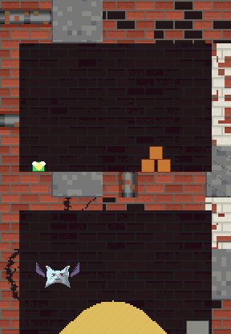

# SlimeJumpHeads



[SlimeJumpDestructSand](../SlimeJumpDestructSand) with heads for enemies and a boss. The heads are made with Blender by code (`tools/prowl_blender.py`, the heads and their face parts from [zigzag](https://github.com/brentharts/zigzag)) and rendered as **32x32** sprites of 8 frames, on bodies drawn as ASCII art, so they sit in the slime's pixel-art style.

| kind | head | where | hp | speed |
|---|---|---|---|---|
| 2 | cat | room 1 | 2 | 2.2 |
| 3 | dog | room 2 | 3 | 1.8 |
| 4 | frog | room 3 | 4 | 1.4 |
| 5 | ogre, the boss | room 6, the vault | 10 | 1.0 |

A head that is shot comes apart into **bricks** (`Bricks.cs`: 8 small boxes, the boss 14, thrown out of where it was and away from the shot). They fall, bounce on the rock and lie there a few seconds; they are on the debris layer, so they meet the walls and the crates and nothing else.

They float, notice the slime within 9 units, drift toward it, and hurt by touch. The bot (`Bot.cs`) shoots a head in sight first; it sees them from 12 units, before they see it. A head is `EnemyCfg` kinds 2 to 5 and the spawn list is `Level.EnemyKind/X/Y`.

## The art

Each enemy is a head rendered with Blender, **32x32**, 8 frames, on a body drawn as ASCII art (`tools/slime_heads/bodies.txt`, the same sprite format as `prowl.py --import-ascii`, so it opens in the editor):

| head | body | frames | picture |
|---|---|---|---|
| cat | `body_bat`: wings that flap | 4 | 64x40 |
| dog | `body_legs`: a trotting body | 4 | 40x50 |
| frog | `body_tentacles`: a waving skirt | 4 | 32x48 |
| ogre | `body_brute`: shoulders, belly and swinging fists | 4 | 72x76 |

In the ASCII, a 32x32 square of `@` is where the head goes, and it can move from frame to frame (the bat's head bobs, the ogre's nods). The body is drawn behind the head.

```
python3 tools/slime_heads/render.py            # -> tools/slime_heads/art/KIND_N.png (the sprite), KIND_head_N.png, KIND.json, anchors.json (needs Blender)
python3 tools/sand_gif.py --sample SlimeJumpHeads   # records the run and draws the enemies over it: slimejumpheads.gif
```

`tools/slime_heads/make_head.py` is the Blender script: `pb.head(kind)`, then a loop of `look`, `blink` and `mouth`. The game is headless and only knows each enemy's collider (`EnemyCfg`, about the head: 1.8 units wide, the ogre 2.8); the picture is drawn by `sand_gif.py` at 16 art pixels to a unit, so a head is 2 units across, the slime 0.9.

Run it: `python3 build.py player Samples/SlimeJumpHeads --run`. The bot wins with no deaths in 2155 steps and shoots all four heads (19 hits); the run fails if it dies, misses a head, or does not get to the bottom. A `death` line says where, and where the heads were.

The bot learned two things for the heads: it does not walk or fall toward a head that has seen it (its gun is what it fights with), and if something it cannot see stops it (a step of sand) it jumps, then shoots the sand away. The heads stand on the far side of each room from where the slime lands.
