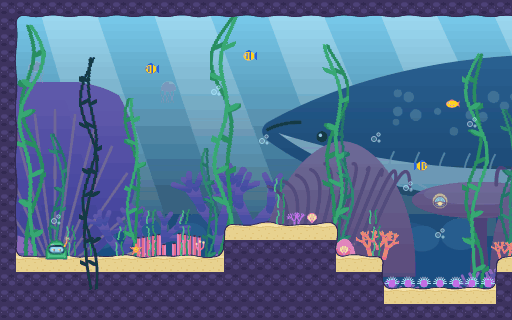

# SlimeJumpLevelang

[`SlimeJump`](../SlimeJump), **underwater**: the same game on a reef. The level is drawn as **[levelang](../../tools/levelang)** art (emoji, one per cell) and every emoji is an SVG: sand and
rock for the ground, kelp to climb, sea urchins for the spikes, oysters with a pearl for the gems, starfish for the checkpoints, a crab and a puffer fish for the enemies, a diving
slime, and the anchor as the goal. Corals, seaweed, fish, bubbles and shells are scenery that the level file scatters with a seeded `rand()`; they have no gameplay flag, so none
of them reaches `Level.cs`. The slime, the enemies, the traps, the lasso and the bot are SlimeJump's scripts, unchanged; the only file that differs is `Level.cs`, and that one is
generated from `level.lvl`.



The look has **depth**, all of it in `level.lvl` (see "Depth" in [levelang's README](../../tools/levelang/README.md)):

- **Parallax layers** (`with layer("whales", parallax=0.10, ...)`): light rays, a blue whale and her calf drifting slowly, a far landscape of coral ridges with giant corals along them, a middle reef with long kelp
  and jellyfish, nearer kelp and fish, and dark kelp in front that rushes past (`over=True`). Each is a stack of SVGs; the kelp sways, the whale and the fish swim, the jellyfish bob, and the far layers are fogged blue
  (`haze`) so they look far.
- **Smooth terrain** (`skin(🟨, 🪨, wobble=0.14, ...)`): the sand and rock are still square cells for the physics, but they are drawn through a rounded, gently wavy outline, with the tiles' own pictures
  showing through.
- **Big corals** of every size from six SVGs (`place(🪸, x, y, size=(s, s))`), scattered along the floor on a `parallax=1` layer so their feet are buried in the smooth ground.

None of this reaches `Level.cs`: layers and the skin are pictures, and the game still sees SlimeJump's level. To look at the layers in the editor's viewport:
`python3 tools/levelang export-project Samples/SlimeJumpLevelang/level.lvl -o /tmp/reef.json && python3 prowl.py /tmp/reef.json` (the editor plays its own physics there, not the SlimeJump game).

| file | what it is |
|---|---|
| `level.lvl` | the level: tile definitions (`def 🌿 -> svg("svg/kelp.svg"), climb, bg, sway(0.03):`), the art of the level, and the code that grows the scenery |
| `svg/*.svg` | the look of each tile, layer and coral. The game is headless and never reads them; the preview does, and so will an engine exporter |
| `Level.cs` | **generated**: wall rectangles, kelp, urchins, saves, gems, enemies, spawn and goal in the form `Game.cs` reads. Edit `level.lvl`, not this |
| `*.cs` | the game, as in `SlimeJump` |
| `level.gif` | the preview: the bot plays the level and a camera follows it, so the layers move at their own speeds |

| tile | means | in the game |
|---|---|---|
| 🟨 sand, 🪨 rock | `solid` | walls |
| 🌿 kelp | `climb` | vines |
| 🔺 urchins | `hazard` | spikes |
| 🦪 oyster | `item` | gems |
| ⭐ starfish | `save` | checkpoints |
| 🦀 crab, 🐡 puffer | `enemy(0)`, `enemy(1)` | the worm (walks, spits) and the flyer |
| 🤿 diving slime, ⚓ anchor | `spawn`, `goal` | start and finish |
| 🪸 🌱 🐚 🐟 🐠 🫧 | no flag | scenery only |

The level has exactly the geometry of `SlimeJump`'s (same spawn, goal, saves, gems, enemies and the same eight wall rectangles; they come out in a different order), so the
bot's route is the one it knows. Sand is the rock that has air above it; change a cell in the picture and regenerate.

## Edit, regenerate, preview

```sh
python3 tools/levelang export-cs Samples/SlimeJumpLevelang/level.lvl -o Samples/SlimeJumpLevelang/Level.cs --layers-from Samples/SlimeJump/Level.cs
python3 tools/levelang gif Samples/SlimeJumpLevelang/level.lvl --view 32x20 --tile 16 --fps 10 -o Samples/SlimeJumpLevelang/level.gif     # needs: pip install cairosvg
```

`--layers-from` copies `LayerRows()` (the layer collision rules) from the game's own `Level.cs`; everything else in the file is the schema the scripts expect. What each
tile word means, and what the exporter checks (one spawn, one goal, shooters must be `solid`, nothing outside `meta(width, height)`), is in [tools/levelang](../../tools/levelang).
`python3 -m unittest discover -s tools/levelang/tests -t tools/levelang` fails if `Level.cs` is out of date with `level.lvl`.

## Run it

```sh
python3 build.py player Samples/SlimeJumpLevelang --run              # translate to C, build, run
python3 build.py player Samples/SlimeJumpLevelang --verify           # ... and compare with the .NET run
```

Not run yet: this sample was written on a machine with no .NET, so the C# was neither compiled nor played. Its scripts are byte-for-byte `SlimeJump`'s and its level data matches
`SlimeJump`'s, so expect `SlimeJump`'s result; check the printed lines against `python3 build.py player Samples/SlimeJump --run` (the wall rectangles are created in a different order,
which could in principle change a contact order in the physics).
