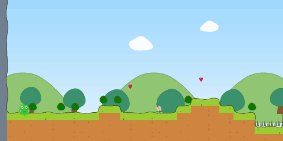

# SlimeJumpRPG



**A story, not just a level.** SlimeJump meets his first girlfriend, Gelly, on a hill; a rival frog, Sir Croak, objects; a dragon, Ember, carries her off; and the slime crosses the
thorn wood, a crumbling bridge and a storm peak to her cage, rescues her and, after all that, proposes at a wedding arch.

It is [`SlimeJumpLevelang`](../SlimeJumpLevelang)'s way of working (a level written in [levelang](../../tools/levelang), `Level.cs` generated from it) with three additions:

- **The people are drawn with [kaomojilang](../../tools/kaomojilang)**: numbers placed in text become shapes, and poses become animations (`kmj/*.kmj`, below). levelang tiles use them with `kmj(...)`.
- **The story is in the level**: `title(x, ...)` is a chapter card and `say(x, ..., who=...)` a line of dialogue, shown when the slime gets to column `x`. The preview GIF waits for each line; the game prints them (`Story.cs`, generated).
- **The scripts are SlimeJump's headless ones** (not `SlimeJumpLevelang`'s `Scenery.cs` / `Viewer.cs`, which the C build cannot translate yet), so the whole sample builds and runs.

## The chapters

| x | chapter | what is in the way |
|---|---|---|
| 0 | SlimeJump, a love story | a meadow: steps, a hill, the first heart gems |
| 34 | 1. The girl on the hill | a thorn pit, Gelly's hill, Sir Croak; Ember snatches her |
| 72 | 2. The thorn wood | thorn pits, bats, a cliff with a vine to climb |
| 102 | 3. The crumbling bridge | a chasm, a bridge whose planks fall, an arrow trap, a bat |
| 137 | 4. The storm peak | pillars to climb, a frog and bats on top |
| 172 | 5. The dragon's keep | brick walls, Ember, Gelly in her cage |
| 190 | 6. Happily ever after | the wedding arch (the goal) |

## The drawings (`kmj/`)

| file | what | animations |
|---|---|---|
| `slime.kmj` | the slime: a body, a shine, stamped eyes and mouths, cheeks; poses squash and stretch the body about its base | `idle` `hop` `look` `love` `happy` `sad` `scared` |
| `gelly.kmj` | Gelly: the same kind of body plus a bow, lashes, a blush and a veil that is only there when asked | `idle` `wave` `blush` `love` `happy` `scared` `cry` `bride` `bride_love` |
| `frog.kmj` | Sir Croak: bulging eyes, a throat sac that swells | `croak` `blink` `glare` |
| `bat.kmj` | a bat with jagged wings | `wings` |
| `dragon.kmj` | Ember: horns, yellow slit eyes, smoking nostrils | `glare` |
| `props.kmj` | beating heart gems, memory flowers, thorns, vines, the wedding arch, a tree, a bush, a cloud, a hill, the keep | `gem` `bloom` `wedding` `tree_sway` |

Each `.kmj` is a grid of numbers (the shape), plus a few lines of Python that pose it. Preview one: `python3 -m kaomojilang Samples/SlimeJumpRPG/kmj/gelly.kmj --svg /tmp/gelly` from `tools/`.

## The tiles

| tile | means | in the game |
|---|---|---|
| 🟩 🟫 🪨 🧱 | `solid` | walls |
| 🌉 | `crumbly` | the bridge: each plank falls soon after it is stepped on |
| 🌿 | `climb` | the vine |
| 🌵 | `hazard` | thorns, always in a pit (the bot jumps walls and gaps, not spikes on flat ground) |
| 💗 | `item` | gems |
| 🌸 | `save` | checkpoints |
| 🐸 🦇 🐲 | `enemy(0)`, `enemy(1)`, `enemy(1)` | the worm (walks, spits) and the flyer; Ember is a big flyer |
| 🏹 | `solid, shooter(-1, 0)` | the arrow trap |
| 🟢 💒 | `spawn`, `goal` | the slime, the wedding arch |
| 👧 🥺 👰 🤵 🐉 🌳 🍀 ⛅ 🌄 🏰 | none | pictures: Gelly, caged Gelly, the bride, the groom, the dragon in the sky, scenery |

## Edit, regenerate, preview, run

```sh
python3 tools/levelang export-cs    Samples/SlimeJumpRPG/level.lvl -o Samples/SlimeJumpRPG/Level.cs --layers-from Samples/SlimeJump/Level.cs
python3 tools/levelang export-story Samples/SlimeJumpRPG/level.lvl -o Samples/SlimeJumpRPG/Story.cs
python3 tools/levelang gif          Samples/SlimeJumpRPG/level.lvl --view 40x20 --tile 12 --fps 6 -o Samples/SlimeJumpRPG/level.gif    # needs: pip install cairosvg
python3 build.py player Samples/SlimeJumpRPG --run          # translate to C, build, play: the bot wins and the story is printed
```

The run (C player, the physics of `SlimeJump`): `won=1 frame=2284 deaths=3 gems=3 slain=7 crumbled=3`, and all 28 story lines are printed. The deaths are the tribulations; the slime respawns at the last flower.
`--verify` (the same run on .NET) needs the .NET 10 SDK and was not run. `python3 -m unittest discover -s tools/levelang/tests -t tools/levelang` fails if `Level.cs` or `Story.cs` is out of date with `level.lvl`.

The GIF's bot is levelang's own (it floats along the free cells and does not play the platforming), so the real run is the C player's; they show the same level and the same story.
