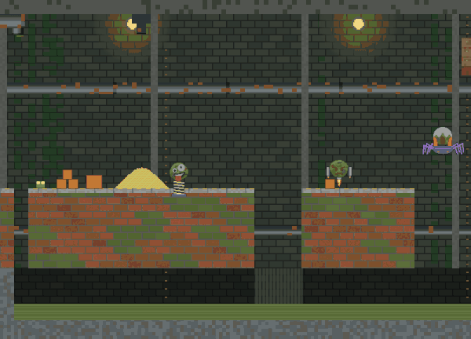

# SlimeJumpStockton

A side-scrolling Prowl2D sample. The slime is in the sewers of Stockton, California: it runs right along a concrete walkway over a lower sewage tunnel, and crosses a deep channel by swinging on its lasso from the undersides of three tanks (a septic tank, a water tank and a plain one) hung from the vault by chains.

It uses the whole destruction stack in one world:

- **PixelTerrain2D (Destruction2D)**: the street, the brick, the gantries and the bedrock are one destructible terrain. Bullets dig holes, and crates and boulders explode into rubble.
- **Sand**: the sand dune and the sealed hopper in the first tank (the septic tank). Shoot its plug and the sand pours out.
- **Water and sewage**: the sewer is filled with sewage, and the water tank floods the channel. The slime swims, slowed by `Cfg.SwimDrag`.
- **Lasso**: the swing from SlimeJump. The bot jumps at the channel edge, hooks tank 1, releases at 25 degrees, hooks tank 2 and lands on the far bank.

Headless like SlimeJumpDestructSand: a bot plays and the program prints. Run it:

    python3 build.py player Samples/SlimeJumpStockton --verify --run

`--verify` checks that the native player and the .NET run print identical output.

Bot notes: it jumps early (a run-up from a wall) so as to arc over a crater wall, and backs off if it is pressed against a wall for half a second.

## The faces

The enemies are the faces of [SlimeJumpFaces](../SlimeJumpFaces) (Grease Pencil heads from `tools/slime_faces` on ASCII art bodies): a zany one on a spring over the first lot, a grump on a jetpack past the drain, a screamer on a spider over the channel's near edge, and the exploding-head boss on a steam golem guarding the goal. They float about their post, come for the slime when they see it, and hurt by touch. The bot shoots them as it goes (each comes apart into bricks), and the run is only `ok` when all four are slain. `Enemy.cs`, `EnemyCfg.cs` and `Bricks.cs` are SlimeJumpFaces'.

`python3 tools/stockton_gif.py` draws the run as a GIF.

## Stomping

Landing on a face's head squashes it (and bounces the slime): `Enemy.cs` checks that the slime is coming down on it, `Shared.StompEnemy` kills it, and `PlayerScript` bounces the slime. Touching one any other way kills the slime. The zany and the grump hover low over the walkway, and the boss (the steam golem) walks, so the slime can come down on its head: the bot stomps all three, jumping when one is close and steering in the air onto its head, and shoots only the screamer on its spider. The run is `ok` only with at least two stomps.

## Flowing

Two inflows keep the sand and sewage moving (`Destruct.Step`): a sewage pipe at the top left pours into a gutter in the walkway, and the sewage runs down into the lower tunnel and along it; a sand chute over the dune in the first lot starts once the slime is past it and builds the dune up. The tanks' sand and water pour into the channel when their plugs are shot. Above the sewer, water that did not come from the water tank is drawn as sewage. `tools/stockton_gif.py` records past the win so the inflows can be seen.
